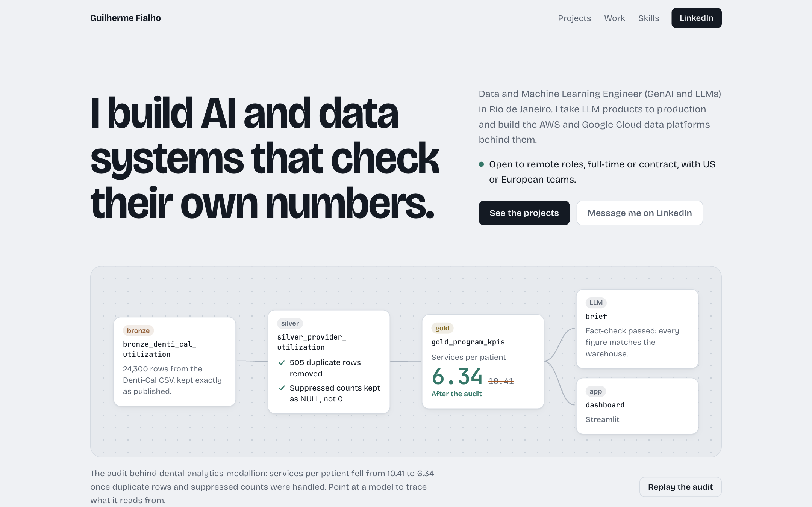
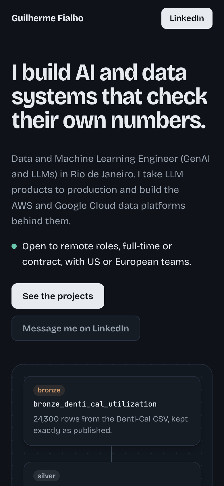

# gcfialho.github.io

Personal site of Guilherme Fialho, Data and Machine Learning Engineer (GenAI and LLMs).
Live at **https://gcfialho.github.io**.

  
  

- **Stack:** Tailwind CSS v4 (compiled at build time) and [Motion](https://motion.dev)
  (bundled with esbuild). Bricolage Grotesque and JetBrains Mono are self-hosted, so the site
  makes no third-party requests and has no trackers.
- **Motion:** one orchestrated moment. The hero replays the real dbt lineage of
  `dental-analytics-medallion`: the first run produces 10.41 services per patient, the audit
  lands in silver, and the rerun settles on 6.34 before anything reaches the LLM brief. Point at
  a model to trace its upstream lineage. `prefers-reduced-motion` is respected, and the markup is
  the final state, so the page is complete without JavaScript.
- **Build:** `npm install && npm run build` writes the site to `dist/`. `npm run preview`
  takes screenshots and records the load sequence. GitHub Actions builds, previews and
  deploys to GitHub Pages on every push to `main`.

Fonts: Bricolage Grotesque (© The Bricolage Grotesque Project Authors) and JetBrains Mono
(© The JetBrains Mono Project Authors), both under the SIL Open Font License 1.1.
